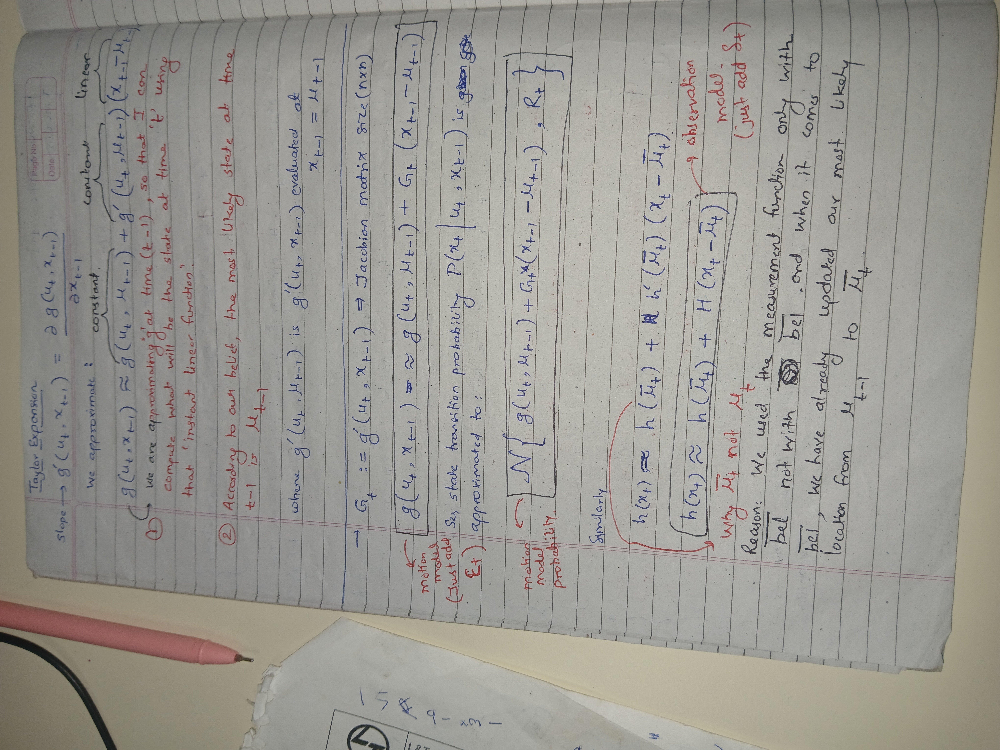
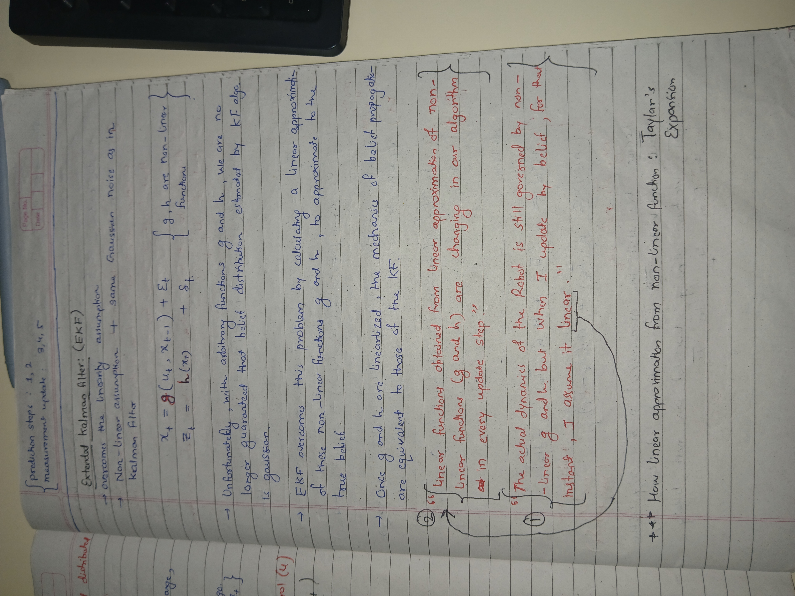
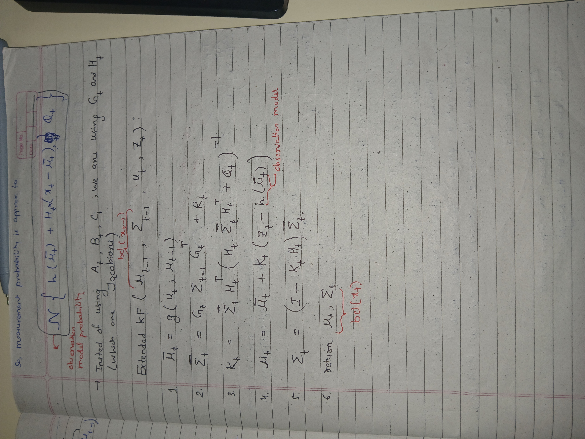
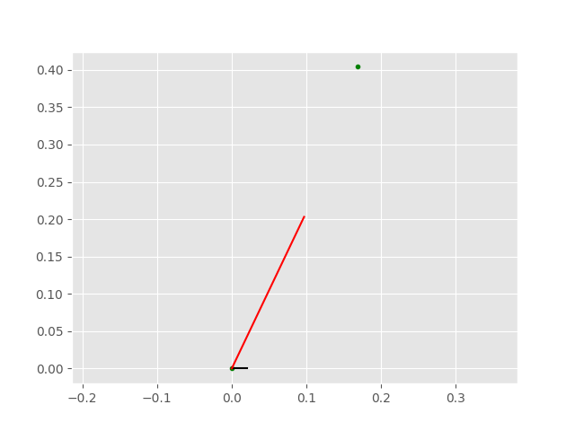
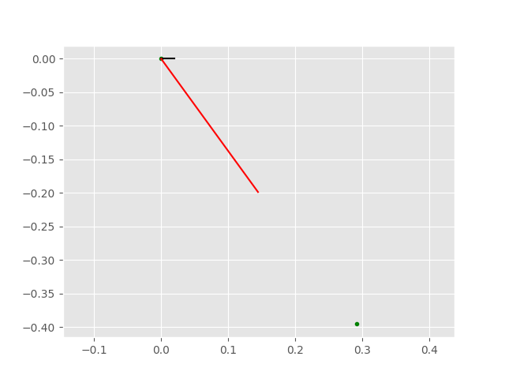
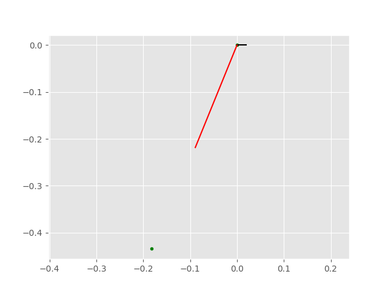

# TheWalkingKalman-One
This project implements an Extended Kalman Filter (EKF) from first principles to estimate the state of an object following a nonlinear trajectory. The simulation demonstrates how nonlinear motion models and noisy measurements can be combined to estimate an object's position and motion over time.

The implementation covers the EKF's two fundamental stages:

1. Prediction: Propagates the estimated state and uncertainty using a nonlinear motion model and its Jacobian.

2. Update: Corrects the predicted state using noisy measurements, refining the estimate through measurement residuals and Kalman gain.

The simulation provides a practical exploration of nonlinear state estimation, uncertainty propagation, and the mathematical foundations of Kalman filtering.

## Extended Kalman Filter (EKF) Mathematical Formulation

The Extended Kalman Filter (EKF) linearizes a nonlinear system dynamic about the current state estimate using a first-order Taylor series expansion (Jacobians) and applies the standard linear Kalman filter loop.

### 1. System and Measurement Models
The system assumes a discrete-time nonlinear dynamic model with additive zero-mean Gaussian noise:

$$x_k = f(x_{k-1}, u_{k-1}) + w_{k-1}$$
$$z_k = h(x_k) + v_k$$

Where:
* $x_k$: State vector at time step $k$
* $u_{k-1}$: Control input vector at time step $k-1$
* $z_k$: Measurement vector at time step $k$
* $f(\cdot)$: Nonlinear state transition function
* $h(\cdot)$: Nonlinear measurement mapping function
* $w_k \sim \mathcal{N}(0, Q_k)$: Process noise with covariance matrix $Q_k$
* $v_k \sim \mathcal{N}(0, R_k)$: Measurement noise with covariance matrix $R_k$

---

### 2. Linearization (Jacobian Matrices)
At each time step, the nonlinear functions are approximated by calculating the partial derivative matrices (Jacobians) evaluated at the most recent state estimate:

* **State Transition Jacobian ($F_k$):**
  $$F_k = \left. \frac{\partial f}{\partial x} \right\vert_{\hat{x}_{k-1|k-1}, u_{k-1}}$$

* **Measurement Jacobian ($H_k$):**
  $$H_k = \left. \frac{\partial h}{\partial x} \right\vert_{\hat{x}_{k|k-1}}$$

---

### 3. The Recursive EKF Loop

The algorithm runs recursively in two main phases: **Predict (Time Update)** and **Update (Measurement Correction)**.

#### Phase 1: Predict (Time Update)
Projects the state and error covariance ahead in time to obtain the *a priori* estimates.

1. **Predicted State Estimate:**
   $$\hat{x}_{k|k-1} = f(\hat{x}_{k-1|k-1}, u_{k-1})$$

2. **Predicted Estimate Covariance:**
   $$P_{k|k-1} = F_k P_{k-1|k-1} F_k^T + Q_{k-1}$$

#### Phase 2: Update (Measurement Correction)
Corrects the predicted state vector using a real-time sensor observation to obtain the *a posteriori* estimates.

1. **Innovation (Measurement Residual):**
   $$\tilde{y}_k = z_k - h(\hat{x}_{k|k-1})$$

2. **Innovation Covariance:**
   $$S_k = H_k P_{k|k-1} H_k^T + R_k$$

3. **Optimal Kalman Gain:**
   $$K_k = P_{k|k-1} H_k^T S_k^{-1}$$

4. **Updated State Estimate:**
   $$\hat{x}_{k|k} = \hat{x}_{k|k-1} + K_k \tilde{y}_k$$

5. **Updated Estimate Covariance:**
   $$P_{k|k} = (I - K_k H_k) P_{k|k-1}$$

---

### Key Notation Summary
* $\hat{x}_{a|b}$: Estimate of state $x$ at step $a$, given all measurements up to and including step $b$.
* $P$: State error covariance matrix (uncertainty metric).
* $I$: Identity matrix.
* $(\cdot)^T$: Matrix transpose operator.
* $(\cdot)^{-1}$: Matrix inverse operator.

# Handwritten Derivation for Extended Kalman Filter

  
  
  

# Simulation for Non-Linear Path Trajectory samples through Extended Kalman filter

  
  

  

